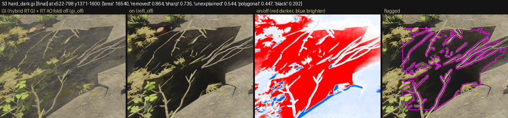
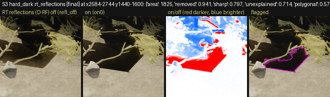

# Image-quality QA harness (`scripts/qa`)

Thumbnails hide artifacts: a 640-pixel preview cannot show a polygonal black
patch under grass, and it cannot tell a soft shadow from a geometry error. The
QA harness checks every scene sweep objectively. It runs one game session per
scene, toggles the effects live between consecutive traces of the same static
view, and measures what each effect does to the frame.

```
python -m scripts.qa run --scenes S1,S3 [--full-res] [--reference] [--temporal 3] [--keep-raw]
python -m scripts.qa analyze captures/qa/<stamp>/<scene> ...   # re-analyse kept raw captures
```

Scene ids are the ones in [TEST_SCENES.md](TEST_SCENES.md) (read from
`scripts/scene-sweep.ps1`). Build first with `scripts/build.ps1`; the harness
runs `auto-run.ps1 -NoBuild -NoAnalyze -Background`, so the user keeps the PC.
Scenes are captured one at a time, each run exclusive: it holds the
`Global\BG3RTX_game_run` mutex that every checkout shares, so a run may first wait
for another agent's game. `--parallel 2` (experimental,
[TEST_SCENES.md](TEST_SCENES.md#concurrent-runs)) runs two lanes, each an
`auto-run.ps1 -Tag a|b -Shared` background run, under one holder that keeps the
mutex for the whole session. Shared runs are marked in `run.json`
(`"exclusive": false`) and in the report ("shared run: not a timing"). Performance
numbers come only from exclusive runs ([QUALITY.md](QUALITY.md) R7).

## One run per scene

`scripts/qa/capture.py` writes the phase plan for `scripts/live_phases.py` and
starts one `auto-run.ps1`. Each phase's settings are applied right after the
previous trace has been written, and the next trace follows `--interval`
presents later (240 by default, enough for RR's history to settle):

| # | Trace | Settings changed before it | Used for |
|---|---|---|---|
| 0..N-1 | `on0`..`on{N-1}` | all on (`rt gi rt_reflections rt_shadows rt_local_shadows`) | baseline, noise σ, flicker |
| (opt) | `nogi0`..`nogi{N-1}` | `gi_strength=0 gi_ao=0` (`--temporal-gi`): all on, the GI's image contribution removed | flicker of the GI alone (on* against nogi*) |
| N | `gi_off` | `gi=0 rt_reflections=0` (D-RF needs `gi=1`; restores `gi_strength`/`gi_ao` after nogi*) | GI contribution (against `refl_off`) |
| N+1 | `refl_off` | `gi=1 rt_reflections=0` | reflection contribution (against `on0`) |
| N+2 | `sun_off` | `rt_reflections=1 rt_shadows=0` | RT sun contribution |
| N+3 | `local_off` | `rt_shadows=1 rt_local_shadows=0` | D-LS contribution |
| N+4 | `sun_dbg` | `rt_local_shadows=1 rt_debug=2 rt_backlit=0` | sun mask against traced visibility and the written mask |
| N+5 | `sun_check` | `rt_debug=7 rt_backlit=1` | `rt_sun_replace` in-frame A/B: the written mask against min(game, traced), same pixel and frame |
| N+6 | `sun_trust` | `rt_debug=6` | the trust of `rt_sun_replace` (TRACK_D 12) |
| (opt) | `ref` | `rt_debug=0 gi_rr_rays=8 ls_samples=2` | `--reference` |
| last N | `off0`..`off{N-1}` | all RT off (`rt=0` and every effect 0) | all-RT contribution, flicker baseline |

`--temporal N` (default 3) sets N. With N = 3 and no reference that is 13 traces (16 with `--temporal-gi`).
The sun debug traces (`sun_dbg`, `sun_check`, `sun_trust`) are each evaluated on their own,
so another view than on0's does not void them. A trace-to-trace A/B cannot isolate
`rt_sun_replace` in animated scenes (water, wind in foliage: 0.28-0.68 of the albedo
changes between traces), so it is measured in one frame instead.
`--full-res` dumps every preview at native size (`dump_png_width=3840`: the
output-res frame at 3840, render-res buffers at 2560); without it previews are
1280 wide, which is enough for regions larger than a few pixels. `--raw` adds
`dump_raw=1`: the final frame as float32 instead of the 8-bit PQ preview, about
1 GB per trace (12 GB per scene) and slower traces, so it is off by default;
the 8-bit PQ code values are fine for ratios of 60%.

Each trace's `dumps.json` and `img/` move to `captures/qa/<stamp>/<scene>/raw/<i>_<phase>/`.

## Buffers

| Name | Dump (by pass hash, FRAME_MAP.md) | Decoding |
|---|---|---|
| final | `d25b8086` RGB10A2 at output size: the tonemapped frame before the UI | HDR10: PQ code → nits; BT.2020 luminance. The flicker metric stays on PQ code values, which are perceptually uniform |
| lighting | `5c3fdabc` R11G11B10F at render size: lit HDR (diffuse + specular + emissive) before transparents and post | preview Reinhard + gamma inverted |
| debug diffuse | `d1669194` (else `7b44a567`) R11G11B10F: the lit diffuse b10 after the tiled lighting, where `rt_debug` writes | `rt_debug=2`: R = game mask × 0.5, G = traced visibility × 0.5, B = visibility written into the mask × 0.5 |
| game sun mask | `0687fa32` R8 (set 1 b7) before our fold | min..max stretch inverted |
| material class | G-buffer RT2 alpha (`aa4efa4d`/`288876d1`) & 7 | |

The specular target b11 is written only by compute and is never a render-pass
attachment, so it is not dumped; reflection effects are measured on the final
frame and the lighting buffer.

## Detectors

Contribution map of an effect: luminance ratio `on / off` after a 3×3 box
(5×5 on the lighting buffer, which is 1 spp before RR) so that sub-pixel jitter
between traces does not show as edges. The noise σ per pixel is the temporal
standard deviation of the `on*` and `off*` traces; a change counts only beyond
3σ. Regions are 4-connected components after a morphological opening, of at
least 2·10⁻⁵ of the buffer's pixels. All thresholds are in
`scripts/qa/detectors.py` (`T`).

Per QUALITY.md R0 the game's image is a reference only for engine inputs. Detectors that
compare an effect's output with the game (brightening, extra or missing casters, the sun
replace) only list crops for review. Gates are artifacts (hard dark, flicker, non-finite)
and physical bounds.

| Detector | Flags | Score (fail above) |
|---|---|---|
| **hard_dark** | the effect removes > 60% of the luminance, with ≥ 50% of the drop inside 3 px of the region edge (`sharp`), and ≥ 50% of the edge where the effect-off image has no edge (`unexplained`: not an object silhouette). `polygonal` (edge energy in 4 of 16 orientations) and `black` (share left with < 10% of the light) are reported. Shadow effects (sun, D-LS, all RT) may be legitimately sharp, so for them a region also needs `black` ≥ 0.25: no real shadow removes the ambient and every other light | qualified area, ‰ of the buffer (0.02) |
| **brightening** (review, not a gate: R0) | the effect brightens beyond its bound: ×1.15 for sun and local shadows (they may only remove light), ×2 for GI, reflections and all RT | area ‰ (0.05) |
| **sun_extra_casters** (review, not a gate: R0) | RT visibility (5×5 box of the 1-spp soft sun) < 0.15 where the game mask > 0.9, after a 3-px erosion (no thin edges, no penumbrae; game mask between 0.1 and 0.9 never counts); unlit, skin, foliage and hair classes excluded (`rt_backlit=0` leaves their back faces untraced). Only pixels the sun term really darkened (lighting ratio `on0/sun_off` < 0.7) count | ‰ (0.5) |
| **sun_missing_casters** (warning, not a gate) | RT visibility > 0.85 where the game mask < 0.1, eroded likewise. With `rt_backlit=0` traced-lit pixels are front-facing, so back faces never count. It cannot change the image (the fold only darkens: mask × visibility) but shows casters missing from the TLAS; off-screen roofs and cut-away walls are expected here | ‰ (2) |
| **sun_replaced** (warning, not a gate) | `rt_sun_replace` wrote the mask lit (> 0.85, 5×5 box) where the game's mask is dark (< 0.1), eroded like the casters detectors: the pixels the replace brightened. Review the crops (min, replace, mask overlay, replace/min ratio): over-dark filtering, acne or cascade transitions are right (R0); a missing caster or roof is wrong. The `rt_sun_replace` effect (`rep_on` vs `sun_min`) also runs the brightening detector with a ×1.15 bound, so its crops list every visible brightening | ‰ (2) |
| **sun_check_far** (warning) / **sun_check_edge** (info) / **sun_check_darker** (gate) | `sun_check` trace (`rt_debug=7`): pixels where the written mask is brighter than min(game, traced) of the same pixel by > 0.1, split by distance to the game's lit mask: at its shadow edge (the game's own mask partly lit, or lit within `rt_sun_near`/2; yellow) and farther (red). Darker than min (blue) cannot happen with `rt_sun_roof_mode=0`. Every far crop is for review: right if it is the game's over-wide penumbra or acne, wrong if a caster or roof is missing. The log line `sun check (...)` gives the same split averaged over 600 frames | far ‰ (0.5), darker ‰ (0.01) |
| **nonfinite** | NaN/Inf over every dump of every trace (`dumps.json`) | count (0) |
| **flicker** | per-pixel temporal std of the final frame's PQ luminance over the `on*` traces against the `off*` traces (effect `all_rt`), and against `nogi*` with `--temporal-gi` (effect `gi`); regions where std_on > 2·std_off + 0.01, on static pixels only: scene motion (G-buffer albedo or the game's own sun mask changed within any set, dilated 3 px) is excluded, because the sets are a minute apart and an NPC that walks in one window and idles in the other is not our flicker. `animated_frac` and the `unmasked` numbers are in the metrics; the crops show the excluded motion as a fourth tile | mean std ratio (1.5), excess area ‰ (1) |
| **reference** (`--reference`) | FLIP of all-on against `gi_rr_rays=8 ls_samples=2` with the same view and RR, minus the noise floor (FLIP of `on0` against `on1`: RR noise and animation) | mean FLIP above the floor (0.03) |

FLIP: `flip_evaluator` is used when installed. It is not installed here, and
nothing is downloaded, so the harness uses a simplified FLIP
(`scripts/qa/flipmetric.py`): YCxCz Gaussian filtering, HyAB in L\*a\*b\* with
FLIP's compression, edge/point feature difference, colour^(1−feature). Its
values follow FLIP's ordering, not its exact numbers.

## Output

`captures/qa/<stamp>/`:

- `report.html`: one summary line per scene, then per scene the overview
  (all-on frame with every reported region boxed and numbered), the mean
  luminance change of each effect, the table of detectors with score,
  threshold and pass/fail, and the crops.
- `summary.json`: the one-line summaries.
- `<scene>/crops/*.png`: 1:1 crop sheets of the worst regions of each failing
  detector, effect and buffer (at most 3 on the final frame, 2 on the lighting buffer): effect off | on | on/off ratio (red darker, blue
  brighter) | the flagged region outlined. Sun sheets show the lighting with
  RT sun off and on, the game mask (red) against the traced visibility (green),
  and the sun term's ratio.
- `<scene>/result.json`: every score, metric and region (bbox in that buffer's pixels).
- `<scene>/run.json`, `phases.json`, `phases.log`, `live_phases.out`,
  `auto-run.out` (tail): what ran.

### Disk hygiene

The raw traces (11-12 per scene, about 0.3-1 GB at `--full-res`) are deleted
after the analysis; only the crops, the overview, the JSON and the report stay
(a few MB per scene). `--keep-raw` keeps them for `analyze`; delete them by
hand afterwards. The trace folders auto-run leaves in `captures/` are moved
into the QA folder and their `frame.json`/shaders dropped at once.

## Runtime

Run `captures/qa/20261026-183106` (main 36f3c6e merged, `--full-res --reference`,
12 traces per scene):

| Step | S3 Campsite | S1 Foundry |
|---|---|---|
| game run (launch, save load, 12 traces 240 presents apart, close) | 410 s | 338 s |
| of which the 12 traces | about 2.5 min | about 2.5 min |
| analysis (8 threads; PNG decode, 10 contribution maps × 2 detectors × 2 buffers, sun, flicker, FLIP) | 23 s | 24 s |
| output kept after pruning | 15 MB | 5 MB |

The game runs dominate; waiting for the shared game mutex comes on top. Without
`--full-res` the traces and the analysis are about 4× lighter.

### Robustness checks built in

- **Same view.** The G-buffer albedo does not depend on any lighting setting, so
  each trace is compared with `on0`'s (3×3 box, |Δ| > 0.1). Wind in grass gives
  0.3-0.7% of pixels; another view gives over 50%. Above 5% (`view_changed_frac`)
  the trace's comparisons are void and a `same_view` failure says which traces
  moved. A run in the foundry once had the camera move between `on0` and the
  later traces; without this check it reported 140‰ of "brightening".
- **G-buffer by signature.** A pass's hash is its first draw's fragment shader,
  which changes with the scene (`aa4efa4d` in the foundry, `181045cc` at camp),
  so the G-buffer is found as the first pass with RG16F in slot 0 and RGBA8 in
  slots 1-3.
- **Noise.** The σ that a change has to beat is the temporal std of the static
  view (RR noise, wind, idle animation), the larger of the all-on and all-off
  sets, max-filtered over 2 px so that a moving edge covers both positions.

## Findings (2026-10-26, main 36f3c6e)

`captures/qa/20261026-183106/report.html`. Summary lines:

```
S3 Campsite - 27h: FAIL - hard-dark: gi (final 15.5‰, lighting 5.4‰); rt_reflections (final 0.80‰, lighting 0.76‰);
  all_rt (final 28.4‰, lighting 0.51‰) | brightening: gi (final 16.4‰), rt_shadows (4.1‰), rt_local_shadows (1.9‰),
  rt_reflections (0.43‰), all_rt (28.0‰) | sun_extra_casters 18.0‰ (> 0.5) | flicker: std on/off 1.46, excess 48.8‰
  | ok: nonfinite, reference, sun_missing_casters
S1 QuickSave_3784: FAIL - brightening: gi (final 2.5‰), rt_local_shadows (0.24‰), rt_shadows (0.10‰), rt_reflections
  (0.07‰), all_rt (0.83‰) | hard-dark: rt_local_shadows (0.24‰), rt_reflections (0.02‰) | flicker: std on/off 2.47,
  excess 1.1‰ | warn sun_missing_casters 242‰ | ok: nonfinite, reference, sun_extra_casters
```

**1. Campsite: black, sharp-edged polygonal patches under the grass come from
the GI and appear in the reflections too.** `hard_dark` for `gi` covers 15.5‰ of
the frame: 58 qualified regions (the largest three are measured here) that remove 86-93% of the light, with sharp
(0.61-0.74) edges that are not in the GI-off image (unexplained 0.54-0.84) and
up to 59% near-black pixels. The polygons sit on flat ground under grass tufts, near
the bottom of the frame
(). D-RF flags the same kind of patch under
a twig and grass, more polygonal (0.57) and darker (71% near-black)
(). The game's mask is lit there.
Hypothesis: grass cards act as opaque quads for the GI's and the reflections'
ray queries. The GI's ambient-visibility term (folded into the AO) then reads 0
under each card, and the reflection rays hit the card's dark underside instead
of the probe. The card silhouettes are triangles and quads, which matches the
polygons. The layer reports no opaque fallbacks (`[alpha] ... opaque fallbacks:
no view 0, UBO 0, SSBO 0, non-finite 0, records full 0`), so cards are not
being turned opaque by capacity limits. The coordinator's A/B (patches vanish
only with `gi=0` and persist with `gi_ao=0`, `rt_origin=0`, `mat_classes=0`,
`rt_bvh_split=0`) points at the per-hit alpha test returning "solid" for these
cards. A separate agent is fixing `rt_common.hlsli`/`alphatest.cpp`.

**2. Campsite: RT sun shadows from the same grass.** `sun_extra_casters`: 38‰
of the frame is RT-dark where the game's mask is lit, after removing penumbrae,
thin edges and foliage/skin/hair pixels. On 18‰ the sun term really darkens
the lighting (on/sun_off < 0.7). Under the grass the RT shadow is a large block with straight edges
where the game's mask is lit
(). The cause is the same as in finding
1: the cards occlude as quads.

**3. Brightening.** Campsite GI brightens 16‰ of the frame by more than 2×,
mostly grass blades lit by bounce where the game's SSAO had them dark. Foundry
GI brightens a 1-2 px crease along stone steps 3.7×: the traced visibility
replaces an SSAO that was very dark there. The sun and D-LS "brightening"
(1.5× bound) is mostly where the effect-off trace uses screen-space contact
shadows instead, which are darker in grass. These are listed for review; the
GI ones fit the "SSAO replaced" design, and none are artifacts like finding 1.

**4. Flicker.** Foundry: all-on flickers 2.5× more than all-off. A region on a
dark metal part at the right edge has std 0.032 in PQ against 0.0002 with RT
off (). Campsite: 1.46×, with 49‰ excess, all
in the grass. The harness measures all-on against all-off, so the flicker is not
attributed to one effect. Next step: a per-effect temporal set, or
`--temporal 2` per effect.

**Update 2026-10-27 (`captures/qa/sun_r0`, S3 17.2‰, S14 19.1‰ excess):** every
cropped region was scene motion, not render noise. The excess is a sharp-edged,
filled plateau in the shape of a character, a character's shadow or wind-blown grass,
and the all-off std has the same outline. In S14 (`flicker_0`) a person-shaped shadow
is present in the off window and absent from `on0`: the RT sun can only darken where
the game's mask is dark (`rt_shadow.hlsl:168` folds `mask × vis`, and
`rt_sun_resolve.hlsl:61` gives trust 0 there with `rt_sun_near=0`), so the game's own
shadow had moved. The on window (08:24:05-08:24:26) and the off window
(08:25:55-08:26:18) were 90 s apart. The detector now excludes that motion, and
`--temporal-gi` measures the GI's own flicker against an all-on set captured next to it.

**5. Sun disagreement in the foundry is expected.** The game's mask is 0
everywhere in the foundry (`game_lit_frac` 0), while the trace finds the sun
through the missing or cut-away roof on 242‰. The fold only darkens, so the
image does not change. This is a warning, not a gate.

**6. Clean:** no NaN/Inf in any dump of any trace. FLIP against 8 GI rays + 2
D-LS samples stays within 0.012 (camp) and 0.008 (foundry) of the RR noise floor.