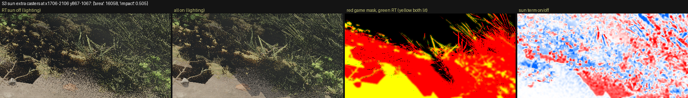
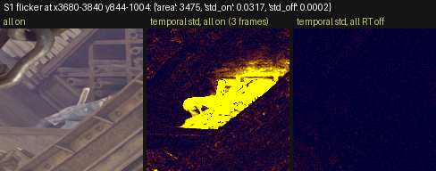

# Image-quality QA harness (`scripts/qa`)

Thumbnails hide artifacts: a 640-pixel preview cannot show a polygonal black
patch under grass, and it cannot tell a soft shadow from a geometry error. The
QA harness checks every scene sweep objectively. It runs one game session per
scene, toggles the effects live between consecutive traces of the same static
view, and measures what each effect does to the frame.

```
python -m scripts.qa run --scenes S1,S3 [--full-res] [--reference] [--temporal 3] [--keep-raw]
python -m scripts.qa analyze captures/qa/<stamp>/<scene> ...   # re-analyse kept raw captures
```

Scene ids are the ones in [TEST_SCENES.md](TEST_SCENES.md) (read from
`scripts/scene-sweep.ps1`). Build first with `scripts/build.ps1`; the harness
runs `auto-run.ps1 -NoBuild -NoAnalyze -Background`, so the user keeps the PC.
Scenes are captured one at a time, each run exclusive: it holds the
`Global\BG3RTX_game_run` mutex that every checkout shares, so a run may first wait
for another agent's game. `--parallel 2` (experimental,
[TEST_SCENES.md](TEST_SCENES.md#concurrent-runs)) runs two lanes, each an
`auto-run.ps1 -Tag a|b -Shared` background run, under one holder that keeps the
mutex for the whole session. Shared runs are marked in `run.json`
(`"exclusive": false`) and in the report ("shared run: not a timing"). Performance
numbers come only from exclusive runs ([QUALITY.md](QUALITY.md) R7).

## One run per scene

`scripts/qa/capture.py` writes the phase plan for `scripts/live_phases.py` and
starts one `auto-run.ps1`. Each phase's settings are applied right after the
previous trace has been written, and the next trace follows `--interval`
presents later (240 by default, enough for RR's history to settle):

| # | Trace | Settings changed before it | Used for |
|---|---|---|---|
| 0..N-1 | `on0`..`on{N-1}` | all on (`rt gi rt_reflections rt_shadows rt_local_shadows`) | baseline, noise σ, flicker |
| (opt) | `nogi0`..`nogi{N-1}` | `gi_strength=0 gi_ao=0` (`--temporal-gi`): all on, the GI's image contribution removed | flicker of the GI alone (on* against nogi*) |
| N | `gi_off` | `gi=0 rt_reflections=0` (D-RF needs `gi=1`; restores `gi_strength`/`gi_ao` after nogi*) | GI contribution (against `refl_off`) |
| N+1 | `refl_off` | `gi=1 rt_reflections=0` | reflection contribution (against `on0`) |
| N+2 | `sun_off` | `rt_reflections=1 rt_shadows=0` | RT sun contribution |
| N+3 | `local_off` | `rt_shadows=1 rt_local_shadows=0` | D-LS contribution |
| N+4 | `sun_dbg` | `rt_local_shadows=1 rt_debug=2 rt_backlit=0` | sun mask against traced visibility and the written mask |
| N+5 | `sun_check` | `rt_debug=7 rt_backlit=1` | `rt_sun_replace` in-frame A/B: the written mask against min(game, traced), same pixel and frame |
| N+6 | `sun_trust` | `rt_debug=6` | the trust of `rt_sun_replace` (TRACK_D 12) |
| N+7.. | `tlas0`..`tlas{max(2,N)-1}` | `rt_debug=8` | the TLAS hit in front of the depth buffer in units of the derived tolerance (`tlas_front`), repeated for its per-pixel spread |
| then | `sun_zero`, `ls_zero`, `all_zero`, `amb_zero` | `rt_debug=0 qa_zero=1`, `2`, `7`, then `4 rt_reflections=0` | the light-off floors of the hard_dark energy gate (`capture.FLOORS`): no direct sun, no D-LS lights, none of the three, no ambient (AO 0, with the GI on and the reflections off). `--no-floors` skips them |
| (opt) | `ref` | `rt_debug=0 gi_rr_rays=8 ls_samples=2` | `--reference` |
| last N | `off0`..`off{N-1}` | all RT off (`rt=0` and every effect 0) | all-RT contribution, flicker baseline |

`--sharc` (the SHaRC radiance cache, `sharc=1`) adds traces after `sun_trust`, with
`sharc=0` as the base of the run (`on0` is the cache-off baseline) and `sharc_stats=1`:
`sharc_on0..N-1` (`sharc=1`, all on: the cache's own noise), `sharc_refl_off`
(`rt_reflections=0`: the GI's own share), `sharc_roof` (`sharc_debug=5`: the roof mask) and
`sharc_leak` (`sharc_debug=6`, `sharc_leak_check=1`, `sharc_reject_occluded=0`). With
`--reference` also `sref0..N-1`, the cache's reference (below). `ref` and `off0` restore the
defaults. Effects `sharc` (`sharc_on0` against `on0`) and `gi_sharc` (`sharc_refl_off`
against `gi_off`) get the usual hard_dark and brightening detectors.
`--temporal N` (default 3) sets N. With N = 3 and no reference that is 20 traces: 13, the three `tlas*` and the four light-off floors (`--no-floors`: 16; +3 with `--temporal-gi`, +3 more with `--temporal-sun`; `--sharc` adds N + 3), plus `--warmup` (default 2) traces before `on0` that are never analysed. The first seconds after a load are not steady, and the on* set is the reference of every comparison.
The sun debug traces (`sun_dbg`, `sun_check`, `sun_trust`) are each evaluated on their own,
so another view than on0's does not void them. A trace-to-trace A/B cannot isolate
`rt_sun_replace` in animated scenes (water, wind in foliage: 0.28-0.68 of the albedo
changes between traces), so it is measured in one frame instead.
`--full-res` dumps every preview at native size (`dump_png_width=3840`: the
output-res frame at 3840, render-res buffers at 2560); without it previews are
1280 wide, which is enough for regions larger than a few pixels. `--raw` adds
`dump_raw=1`: the final frame as float32 instead of the 8-bit PQ preview, about
1 GB per trace (12 GB per scene) and slower traces, so it is off by default;
the 8-bit PQ code values are fine for ratios of 60%.

Each trace's `dumps.json` and `img/` move to `captures/qa/<stamp>/<scene>/raw/<i>_<phase>/`.

## Buffers

| Name | Dump (by pass hash, FRAME_MAP.md) | Decoding |
|---|---|---|
| final | `d25b8086` RGB10A2 at output size: the tonemapped frame before the UI | HDR10: PQ code → nits; BT.2020 luminance. The flicker metric stays on PQ code values, which are perceptually uniform |
| lighting | `5c3fdabc` R11G11B10F at render size: lit HDR (diffuse + specular + emissive) before transparents and post | preview Reinhard + gamma inverted |
| debug diffuse | `d1669194` (else `7b44a567`) R11G11B10F: the lit diffuse b10 after the tiled lighting, where `rt_debug` writes | `rt_debug=2`: R = game mask × 0.5, G = traced visibility × 0.5, B = visibility written into the mask × 0.5 |
| game sun mask | `0687fa32` R8 (set 1 b7) before our fold | min..max stretch inverted |
| material class | G-buffer RT2 alpha (`aa4efa4d`/`288876d1`) & 7 | |

The specular target b11 is written only by compute and is never a render-pass
attachment, so it is not dumped; reflection effects are measured on the final
frame and the lighting buffer.

## Detectors

Contribution map of an effect: luminance ratio `on / off` after a 3×3 box
(5×5 on the lighting buffer, which is 1 spp before RR) so that sub-pixel jitter
between traces does not show as edges. The noise σ per pixel is the temporal
standard deviation of the `on*` and `off*` traces, with the 8-bit preview's rounding
added in quadrature; a change counts only beyond kσ, k from a Bonferroni bound over the
buffer's independent samples (4.8 at 1280 wide, 5.3 at 3840). Regions are 4-connected
components after a morphological opening, of at least the filters' own support (25 px
for a 3×3 box). Every threshold, and where it comes from, is in
[Thresholds and their derivation](#thresholds-and-their-derivation); the code is
`scripts/qa/thresholds.py` and `T` in `scripts/qa/detectors.py`.

Per QUALITY.md R0 the game's image is a reference only for engine inputs. Detectors that
compare an effect's output with the game (brightening, extra or missing casters, the sun
replace) only list crops for review, with no threshold: the report says "review" whenever
they found a region. Gates are artifacts (hard dark, flicker, non-finite) and physical
bounds, and every gate constant is derived (QUALITY.md R0, "Every gate needs a derivation").

| Detector | Flags | Score (fail above) |
|---|---|---|
| **hard_dark** | **Gate (energy bound):** the effect's trace against its light-off floor (`capture.FLOORS`: `sun_zero` for the RT sun, `ls_zero` for D-LS, `amb_zero` for GI and reflections, `all_zero` for all RT). An effect that only removes its own light cannot take a pixel below the image without that light, so floor − on > kσ is light removed that was not the effect's: any such region fails. Pixels whose albedo or normals moved between the two traces (jitter-derived) are excluded. Crops add the floor as a tile. Without its floor trace (`--no-floors`, or a moved view) the effect is review only. **Review (crops, ranking):** regions removing > 60% beyond kσ, with `sharp` (share of the drop across the 3-px edge bands) against the measured step response (`step_like`: sharp ≥ the `sharp` of an ideal step blurred by the pipeline's PSF, measured from the on* repeats, minus z·σ_sharp), `unexplained` (no effect-off edge as steep as the drop), `polygonal`, and `black` (share of the region at its floor: the effect removed all of its own light). `signature` marks the old artifact definition (finding 1); it never gates | ‰ of px below the floor (0) |
| **brightening** (review, no threshold: R0) | the effect brightens beyond kσ and beyond a review bound: ×1.5 for sun and local shadows, ×2 for GI, reflections and all RT. The bounds only choose the crops | area ‰ |
| **sun_extra_casters** (review, no threshold: R0) | RT visibility (5×5 box of the 1-spp soft sun) < 0.15 where the game mask > 0.9, after a 3-px erosion (no thin edges, no penumbrae; game mask between 0.1 and 0.9 never counts); unlit, skin, foliage and hair classes excluded (`rt_backlit=0` leaves their back faces untraced). Only pixels the sun term really darkened (lighting ratio `on0/sun_off` < 0.7) count | ‰ |
| **sun_missing_casters** (review, no threshold) | RT visibility > 0.85 where the game mask < 0.1, eroded likewise. With `rt_backlit=0` traced-lit pixels are front-facing, so back faces never count. It cannot change the image (the fold only darkens: mask × visibility) but shows casters missing from the TLAS; off-screen roofs and cut-away walls are expected here | ‰ |
| **sun_replaced** (review, no threshold) | `rt_sun_replace` wrote the mask lit (> 0.85, 5×5 box) where the game's mask is dark (< 0.1), eroded like the casters detectors: the pixels the replace brightened. Review the crops (min, replace, mask overlay, replace/min ratio): over-dark filtering, acne or cascade transitions are right (R0); a missing caster or roof is wrong. The `rt_sun_replace` effect (`rep_on` vs `sun_min`) also runs the brightening detector with a ×1.15 bound, so its crops list every visible brightening | ‰ (2) |
| **sun_check_far** (review) / **sun_check_edge** (info) / **sun_check_darker** (gate) | `sun_check` trace (`rt_debug=7`): pixels where the written mask is brighter than min(game, traced) of the same pixel by ≥ 1 R8 code (1/255), split by distance to the game's lit mask: at its shadow edge (the game's own mask partly lit, or lit within `rt_sun_near`/2; yellow) and farther (red). Darker than min (blue) cannot happen with `rt_sun_roof_mode=0`. Every far crop is for review: right if it is the game's over-wide penumbra or acne, wrong if a caster or roof is missing. The log line `sun check (...)` gives the same split averaged over 600 frames | far ‰ (review), darker ‰ (0: impossible by construction) |
| **sharc_reference** (gate on the roofed interior, `--sharc --reference`; frame-wide for review) | The radiance cache against its physical reference: `sharc_on0..N-1` (cache on) against `sref0..N-1` (no cache, GI rays as long as the cache's `sharc_gi_radius`, `gi_rr_rays=8`, same denoiser and view; hidden hits without radiance keep the game's ambient, `gi_rt_fallback=1`, since nothing can shade them without the cache), lighting buffer. Tolerances, all measured: per pixel the noise of the difference of the two means, σ_d = √(var_c/N_c + var_r/N_r), from each set's own per-pixel variance (N−1). A pixel is in excess where mean_c − mean_r > σ_d and in deficit where mean_r − mean_c > σ_d; with no real difference both tails are equally likely, so the deficit tail is the measured control. Pixels are counted on a grid as wide as the residuals' measured correlation length (first lag where the autocorrelation drops below 1/e), so the samples are independent. Fails only if the excess count exceeds the deficit count by more than the binomial noise of their difference, √(N_excess + N_deficit). Interior = `sharc_roof` mask minus pixels the game's sun lights. **Limit:** the reference has no radiance at hidden hits, so where the cache supplies hidden surfaces correctly the reference is lower; a fail is then confirmed or explained by `sharc_leak_cells` and the crops | excess − deficit independent px against √(N_e + N_d) |
| **sharc_leak_cells** (report, `--sharc`) | The leak mechanism of a spatial cache: a cell that straddles a wall averages both sides. `sharc_leak` trace (`sharc_debug=6`, `sharc_leak_check=1`, rejection off): per cache hit, a ray from the hit point to the cell centre projected into the hit's plane (both ends lifted by the ULP offset of `rt_offset_ray`; blocked = occluded cell), and a ray into the surface for one cell edge (a slab thinner than the cell). The view holds the cache's GI contribution (luminance) by class; the check reports the share from occluded cells, frame-wide and in the interior. No threshold: a non-zero share is the mechanism at work, and `sharc_reject_occluded=1` (default) drops exactly those entries. The log line `sharc stats ... leak test` gives the same shares over 300 frames | share of the cache's contribution from occluded cells |
| **roofed_brightening** (review map only, `--sharc`; retired as a gate 2026-10-27: its 1.3 ratio and 0.5‰ area have no physical basis) | The SHaRC leak test (DESIGN_SOTA_NEXT 2.7/2.8). Mask from the `sharc_roof` trace (`sharc_debug=5`, `gi/sharc_roof.hlsl`): pixels inside an asset-DB roof volume (roofed room, covered floor; padded as for the sun trust) that the game's own sun mask (`sun_dbg`) does not light (2-px margin), while the game's mask lights at least 1% of the view: interiors whose exterior is sunlit. (The padded volumes alone also cover sunlit exterior walls next to buildings.) On them, lighting-buffer GI brightening `sharc_refl_off / gi_off` > 1.3 (beyond 3σ) is light through geometry (R0) unless GI without the cache already brightens there (`refl_off / gi_off`: on-screen bounce, which cannot pass walls). Score: the roofed area the cache adds, dilated base excluded. Not applicable (pass, with a note) when fewer than 1% of the pixels are roofed with the sun up, or the level's roof volumes are unknown (mask blue). Crops: GI off, GI without and with the cache, ratio, mask | ‰ of the frame added by the cache (0.5) |
| **tlas_front_alpha** (gate) / **tlas_front_opaque** (review) | The geometric check for the class the energy gate cannot see (finding 1: alpha-tested grass cards the trace keeps solid). `tlas*` traces, `rt_debug=8` (`rt_shadow.hlsl`): per pixel the primary ray's TLAS hit against the raster depth, e = (raster − hit) / tolerance, the tolerance being `depth_tol` (jitter-lateral footprint × (tanθ + 1) + depth precision, `shaders/rt/depth_tol.hlsli`) + the measured 0.5% TLAS error; written as log2(e)/8 with the hit's kind. A pixel is in front when the mean log2 e over the traces exceeds kσ, σ² = s²/N + q² (s the spread over the traces, which the jitter and the stochastic alpha test make, max-filtered 1 px; q the rounding of the code through RGBA8, R11G11B10F and the preview), k Bonferroni over the pixels. **Gate:** such px whose hit is alpha-tested in most traces: raster and trace run the same alpha test on that geometry, so a cutout the trace holds in front of the raster surface is texels the trace keeps and the raster discarded. **Review:** opaque hits (cut-away walls, dithered LOD fades: the TLAS keeps geometry the camera faded out, which R0 counts as real). Crops: the lighting, log2 e, the view | alpha ‰ (0) |
| **nonfinite** | NaN/Inf over every dump of every trace (`dumps.json`) | count (0) |
| **flicker** | per-pixel temporal std (unbiased) of the final frame's PQ luminance over the `on*` traces against the `off*` traces (effect `all_rt`), and against `nogi*` with `--temporal-gi` (effect `gi`). Candidate regions: static, std_on − std_off (5×5 box) above one 10-bit PQ step (visible), at least 81 px. A region counts when ln(std_on + q) − ln(std_off + q) over it exceeds z·√(1/2ν_on + 1/2ν_off), with ν = (n − 1) · 81 · n_eff / 25 and n_eff measured from the spatial correlation of the frames' residuals, z Bonferroni over the regions the frame can hold, q half a preview step. Scene motion is excluded: G-buffer albedo, normals or the game's own sun mask changed by more than the sub-pixel jitter can change them (\|∇\| × 1 px + one code step), dilated by the box radius, because the sets are a minute apart and an NPC that walks in one window and idles in the other is not our flicker. INCONCLUSIVE (a fail) when the static px cannot hold one region. `ratio`, `n_eff`, `animated_frac` and the `unmasked` numbers are in the metrics; the crops show the excluded motion as a fourth tile | mean std excess over the static px (one 10-bit PQ step, 0.00098), significant excess area ‰ (0) |
| **reference** (`--reference`) | FLIP of the reference (`gi_rr_rays=8 ls_samples=2`, same view and RR) against every `on*` frame, and of every pair of `on*` frames (RR noise and animation). Rank test: if the reference were one more sample of the same image, all its FLIP values would exceed all the pair values with probability 1/C(n_t + n_n, n_t) = 0.05 for three `on*` frames. With fewer frames it is reported for review | min FLIP(ref, on) − max FLIP(on, on) (0) |

FLIP: `flip_evaluator` is used when installed. It is not installed here, and
nothing is downloaded, so the harness uses a simplified FLIP
(`scripts/qa/flipmetric.py`): YCxCz Gaussian filtering, HyAB in L\*a\*b\* with
FLIP's compression, edge/point feature difference, colour^(1−feature). Its
values follow FLIP's ordering, not its exact numbers.

## Output

`captures/qa/<stamp>/`:

- `report.html`: one summary line per scene, then per scene the overview
  (all-on frame with every reported region boxed and numbered), the mean
  luminance change of each effect, the table of detectors with score,
  threshold and pass/fail, and the crops.
- `summary.json`: the one-line summaries.
- `<scene>/crops/*.png`: 1:1 crop sheets of the worst regions of each failing
  detector, effect and buffer (at most 3 on the final frame, 2 on the lighting buffer): effect off | on | on/off ratio (red darker, blue
  brighter) | the flagged region outlined. Sun sheets show the lighting with
  RT sun off and on, the game mask (red) against the traced visibility (green),
  and the sun term's ratio.
- `<scene>/result.json`: every score, metric and region (bbox in that buffer's pixels).
- `<scene>/run.json`, `phases.json`, `phases.log`, `live_phases.out`,
  `auto-run.out` (tail): what ran.

### Disk hygiene

The raw traces (11-12 per scene, about 0.3-1 GB at `--full-res`) are deleted
after the analysis; only the crops, the overview, the JSON and the report stay
(a few MB per scene). `--keep-raw` keeps them for `analyze`; delete them by
hand afterwards. The trace folders auto-run leaves in `captures/` are moved
into the QA folder and their `frame.json`/shaders dropped at once.

## Runtime

Run `captures/qa/20261026-183106` (main 36f3c6e merged, `--full-res --reference`,
12 traces per scene):

| Step | S3 Campsite | S1 Foundry |
|---|---|---|
| game run (launch, save load, 12 traces 240 presents apart, close) | 410 s | 338 s |
| of which the 12 traces | about 2.5 min | about 2.5 min |
| analysis (8 threads; PNG decode, 10 contribution maps × 2 detectors × 2 buffers, sun, flicker, FLIP) | 23 s | 24 s |
| output kept after pruning | 15 MB | 5 MB |

The game runs dominate; waiting for the shared game mutex comes on top. Without
`--full-res` the traces and the analysis are about 4× lighter.

### Robustness checks built in

- **Same view.** The G-buffer albedo does not depend on any lighting setting, so
  each trace is compared with `on0`'s by phase correlation (sub-pixel peak). The jitter
  moves it by less than 1 px per axis, so a shift of 1 px or more is a camera move: the
  trace's comparisons are void and a `same_view` failure says which traces moved. The
  share of px changed beyond the jitter bound is reported for review (`view_change`):
  wind in grass gives 0.3-0.7%, the S7 harbour 8% in every trace including `on1`,
  which the old fixed 5% limit had called a camera move (`sun_r0/S7`). A run in the foundry once had the camera move between `on0` and the
  later traces; without this check it reported 140‰ of "brightening".
- **G-buffer by signature.** A pass's hash is its first draw's fragment shader,
  which changes with the scene (`aa4efa4d` in the foundry, `181045cc` at camp),
  so the G-buffer is found as the first pass with RG16F in slot 0 and RGBA8 in
  slots 1-3.
- **Noise.** The σ that a change has to beat is the temporal std of the static
  view (RR noise, wind, idle animation), the larger of the all-on and all-off
  sets, with the preview's rounding (step/√12 at the pixel's level) in quadrature,
  max-filtered over the box radius + 1 px (the jitter) so that a moving edge covers
  both positions, ×√2 for a difference of two frames.

## Thresholds and their derivation

Rule (QUALITY.md R0, "Every gate needs a derivation"): a gate, threshold, tolerance or
budget comes from **physics**, the **measured noise** (per-pixel variance of repeated
traces, run-to-run spread), the **display** (a code step, a published perceptual
threshold), the **frame budget** (15.4 ms at a base ≥ 65 fps, split per pass by
SETTINGS_DESIGN) or a **cited standard**. Anything else is review-only: it may choose
crops, never fail a run. Classes below: **derived** (the source is named), **derivable**
(a derivation is proposed, not yet implemented), **arbitrary** (no basis yet).
Inventory of 2026-10-27; the code is `scripts/qa/thresholds.py` and `T` in
`scripts/qa/detectors.py`, checked by `python tests/qa_detectors_test.py` (synthetic
noise, artifacts, jitter and pans; no game).

### Shared statistics

| Constant | Value | Class | Derivation |
|---|---|---|---|
| `ALPHA_FW` | 0.05 | derived (standard) | Family-wise false-alarm probability per test family: the conventional 5% significance level, split over the family's tests (Bonferroni). Every statistical gate below uses it. |
| k (was 3σ) | 4.84 (1280×533, 3×3 box) … 5.26 (3840×1600) | derived (noise) | z(1 − α/n), n = the buffer's independent samples = px / (2·blur + 1)². One expected false pixel per 20 buffers. |
| σ per pixel | temporal std, max of the on*/off* sets | derived (noise) | The run's own repeats; × √2 for a difference of two frames. |
| preview rounding (new) | step/√12 per pixel | derived (display) | 8-bit preview: a static pixel rounds the same way in every frame of one setting, so its temporal std is 0; the rounding of the two settings still differs. Step = decode(code + 1/255) − decode(code) at the pixel's level (PQ for the final frame, Reinhard + γ for the lighting buffer). Skipped for `--raw` float dumps. |
| σ max-filter (was 2 px) | box radius + 1 px | derived (jitter) | A moving edge must cover both positions: the box's own reach plus the jitter (< 1 px). |
| contribution box | 3×3 final, 5×5 lighting | derived (self-consistent) | σ is measured with the same box, so the test stays calibrated whatever the box; 3×3 is the smallest box that absorbs the < 1 px jitter. |
| minimum region (was max(24 px, 2·10⁻⁵ of the frame)) | (2·(blur + r_open) + 1)²: 25 px (3×3, radius-1 opening), 81 px (flicker) | derived (filter support) | A smaller component is the footprint of the filters, not a measured shape. It no longer grows with the resolution, so `--full-res` resolves 9× smaller regions than before. |
| luminance floor (was 5% / 2% of the median) | removed: b > kσ | derived (noise) | A ratio is meaningful where its denominator is significant. |
| ratio ε | 10⁻⁴ × median | derived (numerical) | Below any code step; only avoids 0/0. |
| jitter | 1 px | derived (DLSS/TAA) | Halton offsets within ±0.5 px: two frames differ by < 1 px per axis. |
| one 10-bit PQ step | 1/1023 | derived (display, standard) | ST 2084 places 10-bit steps at about the Barten threshold (Miller, Nezamabadi, Daly 2013). Below it a temporal std is not visible on HDR10. |

### Gates

| Gate | Constant (old → new) | Class | Derivation |
|---|---|---|---|
| hard_dark | gate: removed 0.6 + sharp + unexplained + black → **floor − on > kσ, any region** | derived (physics: energy) | The light-off floor (`qa_zero`, coordinator decision A, 2026-10-27). 8 noise-only seeds: 0 regions; an umbra at the floor passes; light removed below the floor fails (`tests/qa_detectors_test.py`). |
| hard_dark | `black`: < 10% of the light left → **share of the region at its floor** (on − floor < kσ) | derived (physics) | "Removed all of its own light"; review metric. |
| hard_dark | `sharp` ≥ 0.5 → **`step_like`: sharp ≥ step_sharpness(PSF) − z·σ_sharp** | derived (measured) | The PSF is measured from the on* residuals (lag-1 autocorrelation, Gaussian: σ_p = 1/(2√(−ln ρ₁))); the reference is the `sharp` of an ideal step through that PSF and the detector box; σ_sharp from the band medians' noise; z Bonferroni over the regions tested. Review metric. |
| hard_dark | edge strength 0.25 → **ln(1/(1 − 0.6))/(2·blur + 1)** | derived (relative to the 0.6 review bound) | Review metric (`unexplained`). |
| hard_dark | removed 0.6, unexplained 0.5, black share 0.25, bands 3/6–12 px | **review only** | Not derivable: they rank crops and mark the old `signature`, never gate. The grass-card class of finding 1 (opaque cards, visibility 0 where it should be 1) is energetically allowed, so only review and the geometric gate `tlas_front_alpha` (below) see it. |
| flicker | per-pixel `std_on > 2·std_off + 0.01` → **visible** (5×5 std excess > one 10-bit PQ step) **and significant per region** (ln-ratio > z·√(1/2ν_on + 1/2ν_off), ν = (n − 1)·81·n_eff/25) | derived (noise, display) | n_eff = 25²/Σρ²·w from the measured spatial autocorrelation of the residuals (Gaussian: Cov(e_i², e_j²) = 2ρ²σ⁴); z Bonferroni over the regions the frame can hold. Pooled at the minimum-area scale only: a larger region is chosen by the same data (scan statistic). 12 equal-noise seeds: 0 false fails. An 80×80 flickering patch: caught. |
| flicker | mean std ratio 1.5 → **mean std excess ≤ one 10-bit PQ step** (0.00098) | derived (display) | Frame-wide flicker too faint to form a region. Past runs: S6 0.0002–0.0008 (pass), S14 gi 0.00066 (pass: the old 1.67 ratio was rounding), S3 0.0019 before the motion mask. |
| flicker | excess area 1‰ → **0** | derived | Regions are already significance-tested. |
| flicker | INCONCLUSIVE above 60% motion → **when the static px cannot hold one minimum region** | derived | Below that the gate measures nothing. |
| scene motion | albedo 0.1, sun mask 0.15, normal 0.03 → **\|∇ boxed field\| × 1 px + one code step** | derived (jitter, display) | The largest change a static input can show between two jittered frames. The code step is measured from the decoded data, so a preview scaled by the sky sentinel marks nothing (the 0.01 code-step guard in `decode.py` is gone). |
| scene motion | dilation 3 px at 1280 → **the flicker box radius (2 px)** | derived (filter) | A moving pixel's std reaches the box radius into its neighbours. Not covered: the contact lighting (AO, bounce) that moving geometry changes farther out; derivable from the depth and `gi_rt_radius` projected to px. |
| same_view | albedo \|Δ\| > 0.1 on > 5% of px → **global shift ≥ 1 px** (sub-pixel phase correlation of the albedo) | derived (jitter) | A camera move shifts everything; the jitter < 1 px. The changed share is reported for review: S7 had 8% in every trace including `on1` (water), which the 5% limit called a camera move. A rotation or zoom about the centre has no single shift; it shows in the changed share. |
| reference | mean FLIP − FLIP(on0, on1) ≤ 0.03 → **rank test**: min FLIP(ref, on_i) ≤ max FLIP(on_i, on_j) | derived (noise) | Exchangeable values: P = 1/C(n_t + n_n, n_t) = 0.05 with 3 on-frames; with 2 it is reported only. So `--temporal 3` is the minimum for this gate (derived). |
| sun_check_darker | 0.01‰ → **0** | derived (physics) | Darker than min(game, traced) is impossible with `rt_sun_roof_mode=0`. The 0.8/0.2 levels decode the debug colours, not tolerances. |
| tlas_front_alpha | 0.5% fixed band → **depth_tol + kTlasRel**, mean log2 e > **kσ** (σ from the tlas* repeats and the code rounding), alpha-tested hit → any region fails | derived (precision, footprint, measured noise; physics of the alpha test) | Synthetic (`tests/qa_detectors_test.py`): a card 4 tolerances in front in every trace fails; stochastic-alpha px in front in 1 of 3 traces are not significant; an opaque cut-away wall is review only. kTlasRel is the measured bin edge (TRACK_D 7.1), not a derived spread. |
| nonfinite | 0 | derived (correctness) | |
| roofed_brightening (`--sharc`) | ratio 1.3, area 0.5‰, roofed ≥ 1%, sun-lit ≥ 1% | arbitrary | **Not changed here**: the SHaRC branch replaces it with `sharc_reference` (per-pixel σ of repeated cache and reference traces, binomial test on independent samples) and a geometric leak report. |

### Review only (no threshold)

| Detector | Constants | Why review |
|---|---|---|
| brightening | ×1.5 (sun, D-LS), ×2 (GI, reflections, all RT); area 0.05‰ removed | Compared with the game's image (R0). The bounds only pick crops; every significant region is listed. |
| sun_extra / missing / replaced | RT < 0.15 or > 0.85, game > 0.9 or < 0.1, sun ratio < 0.7, erosion 3 px; areas 0.5/2/2‰ removed | Compared with the game's mask (R0). |
| sun_check_far | 0.5‰ removed | Brightening against min(game, traced) is often right (R0); every crop is reviewed. |
| hard_dark `polygonal`, region ranks, crop windows, crops per detector, heat-map ±2 stops, reference crops (FLIP > 0.35, ≥ 400 px), contribution table (> 50% darker, > 2× brighter) | — | Display and ordering. |

### Capture protocol (derivable)

| Constant | Value | Proposal |
|---|---|---|
| `--interval` | 240 presents | Measure RR's convergence: the FLIP of `on_i` against `on_{i+1}` as a function of the interval; the smallest interval at which it stops falling. |
| `--temporal` | 3 | Now derived as the minimum for the reference rank test (α = 0.05); more frames raise the flicker test's power (ν grows with n − 1). |
| preview width | 1280 (3840 `--full-res`) | The smallest artifact of interest at the display: 25 px at 1280 is 225 px at 3840 (0.06% of the frame). |

### Pass criteria in the other docs

Agent inventory of QUALITY.md, TRACK_*, DESIGN_SOTA_NEXT, SETTINGS_DESIGN, TEST_SCENES,
ROADMAP and the HANDOFF files: 52 numeric criteria, 10 derived, 20 derivable, 22 arbitrary.
Not changed here (other tracks own them); the ones that gate decisions:

| Criterion | Where | Class | Proposal |
|---|---|---|---|
| Per-effect budgets 0.15 / 0.6 / 0.5 / 1.0 ms, Track D total ≤ 2.5 ms, build ≤ 1.5/2.0 ms | QUALITY R7, ROADMAP, DSN, TRACK_D | derivable (frame budget) | 15.4 ms − the measured pan frame without Track D (vanilla + RR + build), split by value per ms; write the split down. TRACK_D says 0.5–1.0 ms for reflections, QUALITY 1.0. |
| A regression > 10% needs a justification | QUALITY R7 | arbitrary | > k·σ of the run-to-run spread of exclusive-run medians (TRACK_D measured ±10% between shared runs, the same size as the limit). |
| flicker ≤ current + 1‰; FLIP ≤ +0.01 above the floor | DSN (1a, SHaRC, OMM plans) | arbitrary | The gates above (significant region count 0; FLIP rank test). |
| `rt_sun_near` 1.5 m (QUALITY R0 text, HANDOFF) | QUALITY R0, HANDOFF | *removed* | The proximity trust is gone (runtime list); QUALITY R0 and HANDOFF updated. |
| Sun-replace cost < 0.1 ms | HANDOFF | arbitrary | 0.15 ms sun budget − the measured sun-shadow cost (0.08–0.11 ms): the two limits overlap today. |
| Interior brightened < 0.5‰ | HANDOFF | arbitrary | The detector's null rate in an `rt_sun_replace=0` run of the same scenes. |
| Per-preset budgets (Low ≤ 1.5, Medium ≤ 4, High ≤ 5/7.5 ms) | SETTINGS_DESIGN | arbitrary | Each GPU class's target frame time − its measured vanilla frame. |
| Emissive ratio 0.8–1.25, coverage ≥ 95%, build ≤ 0.5 vs 0.6 ms | HANDOFF (D-EM worktree) | arbitrary | An engine-input parity check (legitimate under R0): band from the measured per-window spread; build from the budget split. |
| Light calibration within 5%; light-tree failed descents < 5%; LBVH variance ≤ 1.3× SAOH | DSN | arbitrary | 5%: the standard error of the per-scene median. Descents: review only (efficiency). 1.3×: convert the variance ratio to extra rays and compare in ms. |
| CPU oracle within 5.5σ (900 tests) | DSN | derivable | Bonferroni at α = 0.05 over 900 one-sided tests gives z = 3.9 (two-sided 4.0); state the α used. |
| Exact-delta replication < 1% mean error | QUALITY R3, TRACK_D | derivable | The target format's quantisation (R11G11B10: 6-bit mantissa, about 1.6%) or two identical runs. |

### Runtime heuristics that need a decision

Not changed here (rendering defaults are the coordinator's). Agent inventory of `core/`,
`shaders/`, `layer/` and `bg3rtx.ini`: 86 quality decisions, 32 derived, 26 derivable,
28 arbitrary. Defects found on the way (verified in the code):

- *Fixed:* `rt_sun_near=0` did not switch the proximity test off (`near` started at the
  pixel's own game mask, trust `saturate(near·2 − 0.5)`). The proximity term is removed:
  trust = roofs and the frustum term only; `rt_sun_near` splits the A/B debug class only.
- *Fixed:* D-RF started its rays at `P + N·dist·rt_bias`; it now uses `rt_ray_origin`
  (binding 40 added to its push set, which is now at the 32-descriptor limit).
- *Fixed:* a ray query that hit `kMaxCandidates` (4096) was aborted with nothing committed,
  so a shadow ray counted as unoccluded. `rt_visibility()` is tri-state; an unknown query
  takes the game's own term (sun mask; D-LS shadow map, or unshadowed where the game never
  shadows; reflection probe), GI and AO count it as occluded. Counted per pass in the
  `[core] guard:` line; `rt_max_candidates` forces aborts for tests (TRACK_D 13).
- *Fixed (logged, not silent):* `kSunMaxVolumes` 256: volumes beyond it are dropped
  farthest first, logged once per level (`sun: WARNING N roof volumes ...`) and counted in
  `sun stats`. Measured: at most 183 within 600 m of any volume centre (TRACK_D 12.1).
- *Fixed:* code defaults differed from the ini (`rt_sun_near`, `rt_sun_top`, `gi_rays`,
  `gi_steps` and 10 more). `common/settings.h` `kDefaults` is generated from `bg3rtx.ini`
  (`scripts/gen_settings_defaults.py`), `cfg_*` fall back to it, a disagreeing call-site
  literal is logged, and `settings_test` checks ini and table agree (SETTINGS_DESIGN 10).

The arbitrary ones with the most effect on the image:

| Heuristic | Where | Value | Proposed derivation |
|---|---|---|---|
| Sun trust from the game mask, `saturate(near·2 − 0.5)`, `rt_sun_near`, ring weights 1/1/0.66/0.33, R clamp 2..96 px | `rt_sun_resolve.hlsl`, ini | 0.25..0.75, 1.5 m | *Done:* removed; trust = roofs and frustum. The ring search (R clamp, depth test) remains for the `rt_debug=7` edge/far split only. |
| A/B classes in the shader: brightened / darker by > 0.1 | `rt_sun_resolve.hlsl` | 0.1 | *Done:* one R8 code step (1/255). `rtVis` is RGBA8 and the mask R8, so there is no fp16 rounding to add. |
| GI distance falloff `1 − (t/R)²` on occlusion *and* bounce | `gi_trace_rt.hlsl`, `rt_ao.hlsl` | — | No physical basis for the bounce; keep it unfaded and account for the truncation with the IBL remainder. |
| `gi_rt_radius` | ini | 1 m | From the measured tier mix once the cache or fallback exists (DSN A/B planned). |
| Roof padding 1 m sideways / 3 m up, `rt_sun_rise` 6 m, `rt_sun_roof_radius` 120 m (< `rt_tmax` 300 m) | ini, `sun_trust.cpp` | — | From the asset DB: roof mesh AABB minus trigger AABB per level; tallest caster in the ray's footprint; radius ≥ the farthest traced pixel's reach. *Radius done* (farthest roof-tested pixel + `rt_tmax`, per frame). Pad, up and rise: the DB has no meshes (`scripts/roof_stats.py`); TLAS experiment in TRACK_D 12.4. |
| `ls_clear` | ini | 0.2 m | The fixture's own radius, or skip the first back-facing hit: today every occluder within 20 cm of a light is ignored. |
| Source radii (0.05 m and the fixture table) | ini, `assetdb.cpp` | — | Measure the emitter mesh in the TLAS or asset DB ("typical sizes, not measured"). |
| GI temporal depth reject 3%, bilateral σ 1% depth, `gi_rt_depth_tol`/`rf_depth_tol` 0.03 | `gi_temporal.hlsl`, `gi_common.hlsli`, ini | — | *Done* (`shaders/rt/depth_tol.hlsli`, TRACK_C): footprint × (tanθ + 1) + depth precision + jitter (+ the measured 0.5% TLAS error where no per-pixel reference exists); the keys are now multipliers `gi_rt_depth_k`/`rf_depth_k` = 1. Left: the temporal test's camera-translation term (3%) needs the previous camera position in that pass. SS offsets 0.003/0.002·dist and `gi_thickness` 0.03 not done. |
| TLAS↔depth match window max(1%·dist, 16 px) and tolerance | `rt_origin.hlsl` | — | *Done:* the same helper with the measured 0.5% term. |
| `sharc_frames` 16, `sharc_stale` 128, `sharc_rf_rough` 0.2 | ini | — | Cache lag as a time budget against the variance it removes; stale from measured occupancy. |
| `rf_max_rough_norr` 0.3, `rf_edge` 0.05, `dot(n, dir) < 0.2`, `rf_tmax` 100 m, `rt_tmax` 300 m | ini, `rt_reflections.hlsl` | — | Roughness at which the mirror bias exceeds a JND; `< 0` plus the normal precision; the game's last cascade distance. |
| Light-join tolerances (character 4 m, static 5 cm, radius 2% + 1 cm) | `ls_lights.cpp`, `assetdb.cpp` | — | *Done* (SE_BRIDGE "Join tolerances"): static √3·(4 ulp + 0.05 mm); moving = static + `ls_dyn_speed` (8 m/s, the game's commonest sprint/dash template) × the measured export age; radius (placed) 0.5 mm + 4 ulp; refresh on each export; stale after 4 periods; the 55 m sphere → the export's real coverage. Left: the radius of moving (VFX) lights stays 2% + 1 cm, now logged for measurement. |

## Findings (2026-10-26, main 36f3c6e)

`captures/qa/20261026-183106/report.html`. Summary lines:

```
S3 Campsite - 27h: FAIL - hard-dark: gi (final 15.5‰, lighting 5.4‰); rt_reflections (final 0.80‰, lighting 0.76‰);
  all_rt (final 28.4‰, lighting 0.51‰) | brightening: gi (final 16.4‰), rt_shadows (4.1‰), rt_local_shadows (1.9‰),
  rt_reflections (0.43‰), all_rt (28.0‰) | sun_extra_casters 18.0‰ (> 0.5) | flicker: std on/off 1.46, excess 48.8‰
  | ok: nonfinite, reference, sun_missing_casters
S1 QuickSave_3784: FAIL - brightening: gi (final 2.5‰), rt_local_shadows (0.24‰), rt_shadows (0.10‰), rt_reflections
  (0.07‰), all_rt (0.83‰) | hard-dark: rt_local_shadows (0.24‰), rt_reflections (0.02‰) | flicker: std on/off 2.47,
  excess 1.1‰ | warn sun_missing_casters 242‰ | ok: nonfinite, reference, sun_extra_casters
```

**1. Campsite: black, sharp-edged polygonal patches under the grass come from
the GI and appear in the reflections too.** `hard_dark` for `gi` covers 15.5‰ of
the frame: 58 qualified regions (the largest three are measured here) that remove 86-93% of the light, with sharp
(0.61-0.74) edges that are not in the GI-off image (unexplained 0.54-0.84) and
up to 59% near-black pixels. The polygons sit on flat ground under grass tufts, near
the bottom of the frame
(). D-RF flags the same kind of patch under
a twig and grass, more polygonal (0.57) and darker (71% near-black)
(). The game's mask is lit there.
Hypothesis: grass cards act as opaque quads for the GI's and the reflections'
ray queries. The GI's ambient-visibility term (folded into the AO) then reads 0
under each card, and the reflection rays hit the card's dark underside instead
of the probe. The card silhouettes are triangles and quads, which matches the
polygons. The layer reports no opaque fallbacks (`[alpha] ... opaque fallbacks:
no view 0, UBO 0, SSBO 0, non-finite 0, records full 0`), so cards are not
being turned opaque by capacity limits. The coordinator's A/B (patches vanish
only with `gi=0` and persist with `gi_ao=0`, `rt_origin=0`, `mat_classes=0`,
`rt_bvh_split=0`) points at the per-hit alpha test returning "solid" for these
cards. A separate agent is fixing `rt_common.hlsli`/`alphatest.cpp`.

**2. Campsite: RT sun shadows from the same grass.** `sun_extra_casters`: 38‰
of the frame is RT-dark where the game's mask is lit, after removing penumbrae,
thin edges and foliage/skin/hair pixels. On 18‰ the sun term really darkens
the lighting (on/sun_off < 0.7). Under the grass the RT shadow is a large block with straight edges
where the game's mask is lit
(). The cause is the same as in finding
1: the cards occlude as quads.

**3. Brightening.** Campsite GI brightens 16‰ of the frame by more than 2×,
mostly grass blades lit by bounce where the game's SSAO had them dark. Foundry
GI brightens a 1-2 px crease along stone steps 3.7×: the traced visibility
replaces an SSAO that was very dark there. The sun and D-LS "brightening"
(1.5× bound) is mostly where the effect-off trace uses screen-space contact
shadows instead, which are darker in grass. These are listed for review; the
GI ones fit the "SSAO replaced" design, and none are artifacts like finding 1.

**4. Flicker.** Foundry: all-on flickers 2.5× more than all-off. A region on a
dark metal part at the right edge has std 0.032 in PQ against 0.0002 with RT
off (). Campsite: 1.46×, with 49‰ excess, all
in the grass. The harness measures all-on against all-off, so the flicker is not
attributed to one effect. Next step: a per-effect temporal set, or
`--temporal 2` per effect.

**Update 2026-10-27 (`captures/qa/sun_r0`, S3 17.2‰, S14 19.1‰ excess):** every
cropped region was scene motion, not render noise. The excess is a sharp-edged,
filled plateau in the shape of a character, a character's shadow or wind-blown grass,
and the all-off std has the same outline. In S14 (`flicker_0`) a person-shaped shadow
is present in the off window and absent from `on0`: the RT sun can only darken where
the game's mask is dark (`rt_shadow.hlsl:168` folds `mask × vis`, and
`rt_sun_resolve.hlsl:61` gave trust 0 there even with `rt_sun_near=0`, a defect fixed
2026-10-27: trust is now roofs and frustum only), so the game's own
shadow had moved. The on window (08:24:05-08:24:26) and the off window
(08:25:55-08:26:18) were 90 s apart. The detector now excludes that motion, and
`--temporal-gi` measures the GI's own flicker against an all-on set captured next to it.

**Run `20261027-112818` (`--temporal-gi`):**
- **S3 `all_rt`, 17.7‰ masked:** all of it in wind-blown grass. The std has the blade-streak pattern of the all-off set, and the static dirt next to it has no speckle. The albedo misses a blade moving in front of grass of the same colour, so a G-buffer normal change now also counts as motion (`anim_normal`). This gate cannot see flicker on moving geometry: 240 presents apart, motion and noise are inseparable there.
- **S3 `gi`, 2.3‰:** isolated hot spots in dark areas (forest at the top), present in on* and absent from nogi*. Those are rare, very bright 1-spp bounce hits. The bounce source held the specular the camera saw (sun glints), against R3. It is now the diffuse part only (`gi_bounce_spec=0`; D-RF still reads diffuse + specular).
- **S14 `gi` ratio 1.67 with 0‰ excess:** 0.00164 against 0.00098 PQ, both below one 8-bit code step (0.0039). The ratio now adds half a step to both sides (`flicker_quant`).
- **Follow-up runs `gi_flicker2_diffuse` / `gi_flicker2_spec` were void for the flicker gate:** the normal criterion masked 100% of S3 (98% of S14 spec). The 8-bit preview of the RG16F normals scales by the channel's max |value|, which is the sky sentinel (`|e|² > 5.4e10`), so one code step exceeds any real change. Normals are now used only from `.f32` dumps or a preview whose code step is ≤ 0.01, and a flicker check with more than 60% of the frame excluded fails as INCONCLUSIVE instead of passing. Unmasked, the two bounce sources are within run-to-run spread (S3 gi 16.1‰ diffuse vs 17.5‰ spec, S14 13.8‰ vs 19.7‰; the earlier spec run gave 11.1‰ and 12.8‰). `gi_bounce_spec=0` stays for R3; its flicker benefit is unproven.
- **Runs `gi_flicker3_diffuse` / `gi_flicker3_spec` (valid masks, 29-38% motion):**
  - **GI flicker:** with the diffuse source, S3 0.57‰ and S14 0‰ (pass). With the old specular source, S14 is 2.84‰ (fail): a soft halo on the sand next to an armoured character (`gi_flicker3_spec/S14/crops/flicker_gi_0.png`). Its moving highlights were being bounced, and the S14 `all_rt` failure of that run (2.38‰) is the same two regions. **Verdict:** keep `gi_bounce_spec=0`.
  - **S3 `all_rt`, 2.0-2.1‰ in both runs, GI not involved:** blade streaks in wind-blown grass with the all-off pattern, the motion the albedo cannot see and the preview normals cannot give. `--temporal-sun` (a `nosun` set) attributes it.
- **Run `flicker4_split` (`--temporal-gi --temporal-sun`):**
  - **S14 passes every flicker check** (all_rt 0‰, gi 0‰, rt_shadows 0‰, 29% motion excluded).
  - **S3 is void.** During the on window (the first 15 s after the load), fire FX burned across the camp: flame sprites with embers on the rocks, the tents and the log. The overview shows them, and the std inside them is 0.07-0.26 PQ. They were gone by the nogi, nosun and off windows, whose std there is low. Burning transparents are not in the G-buffer, so the motion mask cannot see them. All three S3 failures (all_rt 24‰, gi 33‰, rt_shadows 30‰) are in those regions. **Re-run S3.**
- **S14 GI brightening, 58‰ final (review):** shaded sandstone faces next to sunlit stone and sand get 3-4× the sky ambient from the bounce. This is plausible for a sunlit canyon, and not an artifact.

**5. Sun disagreement in the foundry is expected.** The game's mask is 0
everywhere in the foundry (`game_lit_frac` 0), while the trace finds the sun
through the missing or cut-away roof on 242‰. The fold only darkens, so the
image does not change. This is a warning, not a gate.

**6. Clean:** no NaN/Inf in any dump of any trace. FLIP against 8 GI rays + 2
D-LS samples stays within 0.012 (camp) and 0.008 (foundry) of the RR noise floor.
**7. S6 Adamantine Forge, green walls (2026-10-27).**
- **Symptom:** `captures/compare/Adamantine_Forge_on.png` (10:17, main at about `51725f5`). 40k px of the far, lava-lit walls are pure green. Median 80/283/21 nits against 22/13/6 with RT off: G ×25, R ×4, B ×3, luminance ×14.
- **Not reproduced on the same view in any later run:**
  - `qa/20261027-111341` (11:13; main after `818000d`, 10:57);
  - `qa/20261027-150845`;
  - `qa/20261027-153326` (13 traces with per-effect toggles).

  The all-on overviews have 0 green px.
- **Mechanism:**
  - Only one pass adds light of its own colour onto those walls: D-LS's AO-on-direct give-back (`ao_direct=1`). It adds `(traced lights + the sun's direct light) × (1 − fdif)`, with the sun recomputed from set 2 (the game's transmittance LUT and cloud maps).
  - Before `818000d`, that set was rewritten by frame count while dispatches could still bind it, so D-LS could sample a freed or reused view as the transmittance LUT: a wrong sun colour, scaled by (1 − AO). That fits the green following the carvings and creases.
  - No debug path is on by default. The non-finite guards cover every write. A stored half-float overflow (R11G11B10F) cannot give G ×25 with R and B up too.
- **Fix in depth:**
  - `ls_giveback_cap` (`gi_common.hlsli`, used by D-LS, its full variant and `ls_ref`) bounds the give-back per channel by what the game's pixel implies: `g × (f_to − f_from) / f_from`, with g the lighting's output after the D-LS delta.
  - When the recomputed sun is right, the cap never binds: the game's pixel holds direct × fdif plus non-negative ambient.
- **Non-finite 6020:** the game's own D32F depth (`76433aef`; `2a6a525c` in other captures), non-finite with RT off as well: about 5000 per trace in off*. The detector now scores only dumps that are non-finite with RT on and never with RT off; the game's dumps are listed as `game_owned`.
- **GI hard-dark 9.29‰:** the floor under the rims of the large platforms. The 1 m traced visibility sees the overhang that the game's SSAO misses: contact occlusion, review, with no black core (`black` 0.0).
- **Re-run with the cap (`qa/20261027-155053`, main `253e437` not yet merged):**
  - 0 green px in the all-on overview. Non-finite passes, with the game's D32F (`9aaa6d61`) listed as game-owned.
  - The D-LS review brightening is 0.25‰, against 0.97-1.81‰ in the two runs before the cap.
  - The GI hard-dark (8.1‰) and the all_rt flicker excess (7.1‰) are where they were before the cap (5.4-8.9‰).
- **`ls_check=1` with the cap (`s6-lscheck-cap`):** live and reference differ on 1.5-20% of px, but that run had `ls_shadowed=3`, and the frozen reference knows modes 0-2 only (TRACK_D_RT 9.10). Bit-exactness needs `ls_shadowed=0`.

**8. S3 grass attribution (`qa/20261027-155410`, `--temporal-gi --temporal-sun`).**
- **Grass:** with the RT sun off, the moving-blade std drops from 0.050 to 0.0043 (`crops/flicker_rt_shadows_2.png`). The GI split does not flag the grass. The residual is therefore the RT sun's sharp per-blade shadows on wind-blown grass: physically expected (R0), though stochastic alpha noise on the moving blades cannot be separated at 240 presents.
- **The two largest regions** (open dirt, std 0.022 vs 0.0013-0.0017) are a smooth brightness drift present in on* only, under every split. Together with the fire of `flicker4_split`, this is the first window after the load not being steady, hence `--warmup`.
- **`qa/20261027-174810` (`--warmup 2`, re-analysed with the derived thresholds of `253e437`):**
  - The open-dirt drift is gone: the warm-up worked. Every remaining flicker region is wind-blown grass or foliage.
  - Mean std excess over the static pixels: all_rt 0.0020 PQ (above one 10-bit step), gi 0.0007, rt_shadows 0.0003 (both below a step).
  - GI and the RT sun each sharpen the per-blade lighting that the wind moves. Telling that apart from noise needs traces closer than 240 presents.
  - The derived motion mask first marked 99.6% of the frame. The game's sun mask is a dithered PCF that differs on static pixels between any two frames, and the jitter bound alone (|grad| × 1 px + one code step) took that dither for motion. The bound now adds the input's own measured frame-to-frame noise (MAD × 1.4826 of the difference, at the buffer's kσ): 42% marked, the albedo 9% and the sun mask 30% per set, mostly swaying tree shadows. The case is in `tests/qa_detectors_test.py`.
- **`s6-lscheck-mode0` (`ls_check=1 ls_shadowed=0`):** live and reference still differ on 1.5-19% of px. Since `c650dac` the live pass skips the darkvision light (`ls_noshadow=1`), which the frozen reference does not know, so this run cannot isolate the cap. `ls_giveback_cap=0/1` (ls_flags bit 18, in both passes) makes the A/B possible.
