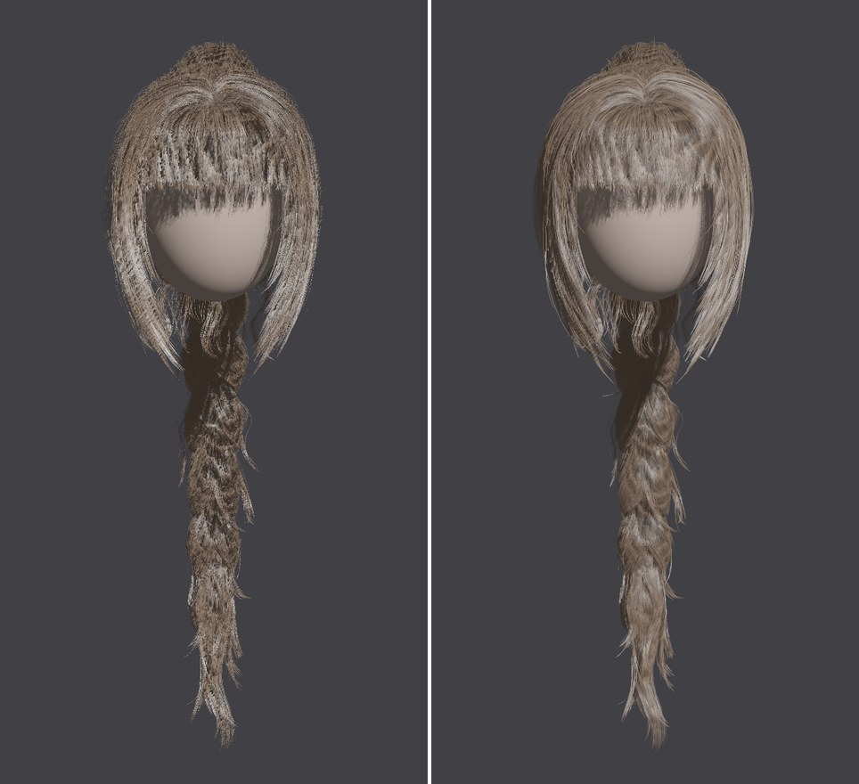
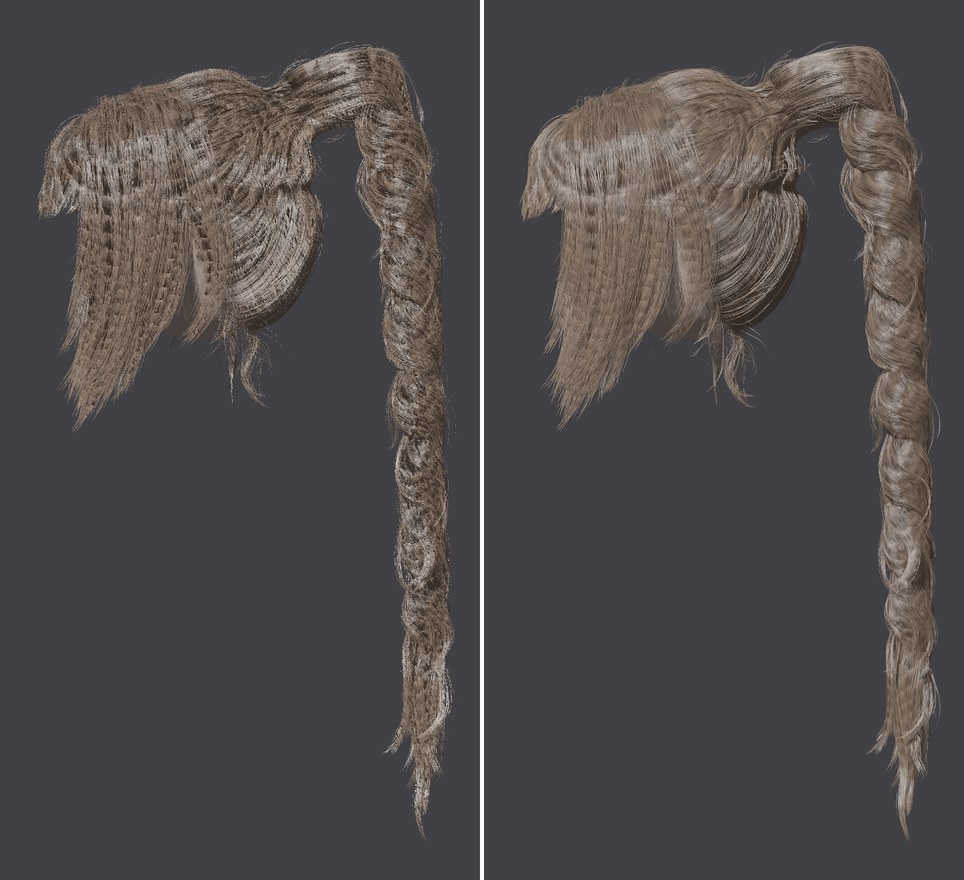
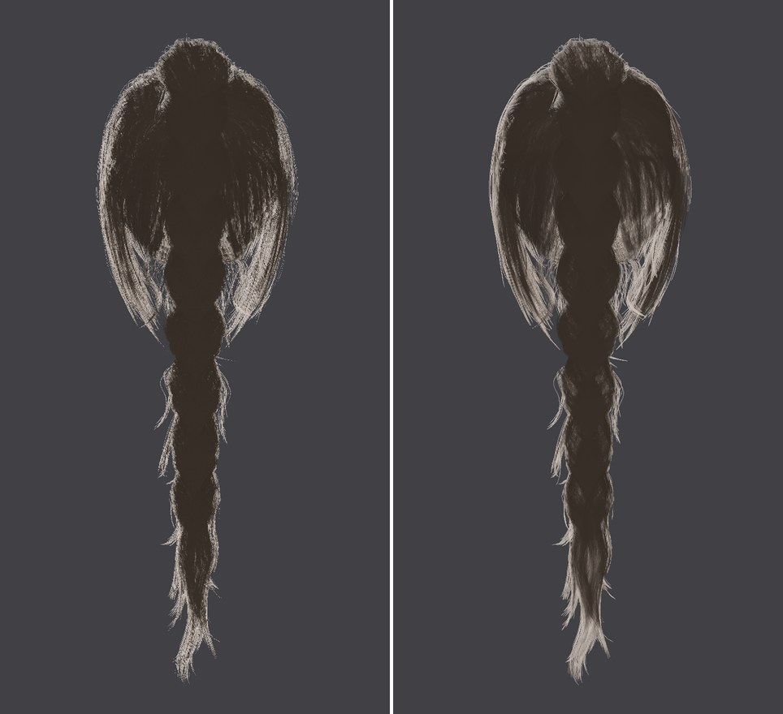
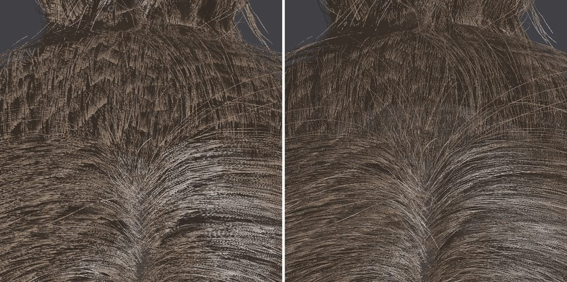

# Card-to-strand groom experiment (Shadowheart hair)

2026-11-03, offline only (no game, GPU, runtime, shader, ABI or settings change). CTest `hair_groom_test`.
`python -m tools.hair_groom --gltf <LSLib export of HAIR_HUM_F_Shadowheart_Spring.GR2> --out <new dir>`.

**Verdict: approximate.** The strands reproduce the cards' silhouette, density and root/tip layout,
but this is not a real groom: short pieces lying on the card sheets, no volume between sheets.
Usable for RT secondary rays (shadows, GI, reflections); not for strand simulation or close-ups.

## Method
- Input: LOD0 hair (33,513 vertices, 40,090 triangles; RTX_HAIR_FEASIBILITY.md) and its CHAR_Hair
  mask `HAIR_Shadowheart_Evil_MSKA.DDS` (2048^2 DXT5, Textures.pak, read-only). A = coverage,
  B = root (0) to tip (1), R = per-strand ID.
- 656 cards (connected strips); each card's UV0 covers exactly one tile of an 8x2 atlas. Rows run
  root to tip: row vs B correlation 0.89..0.96 in all 16 tiles.
- Per tile, strands are traced in texture space: covered runs per row (alpha >= 0.5), clumps split
  by the median painted width, rows linked by slope-predicted nearest centre, pieces cut at crossings
  stitched back. They redraw 98.4..100% of the covered texels; binarising keeps the alpha mass (1.004).
- Each sample (u, v) is located in its card's UV triangles: barycentrics give the 3-D point, bone
  weights (4 largest) and radius (painted width through the UV->world Jacobian). Every point keeps
  (triangle, barycentrics), so at runtime it can follow the layer's captured deformed card vertices
  (spring physics included) without its own skinning.

## UV consistency
- No UV overlap inside a card (0 of 943k samples), no mirrored winding, 2 cards straddle a tile edge;
  22 of 656 cards (3.4%) have the root farther from the head than the tip (bun and braid loops).
- Layered cards: 19.5% of strand points have another card's point within 0.5 mm; 3,892 strands (4.5%)
  are >80% duplicated by a stacked card on the same tile. Kept: they are on screen too.

## Numbers (one character)
| | Cards now | Groom, 2 mm segments | 4 mm | 8 mm |
|---|---:|---:|---:|---:|
| Primitives | 40,090 tris | 856,802 segments | 451,094 | 248,889 |
| Points / vertices | 33,513 | 942,998 | 537,287 | 335,082 |
- 86,196 strands, length p5/p50/p95 2/14/71 mm; radius 0.054/0.125/0.35 mm (clumps, ~3x a hair); ~6 s/style.
- Memory at 2 mm: LSS positions+radii 15.1 MB (16 B/point), indices 3.4 MB, embedding 11 MB; cards
  today 2.9 MB captured vertices (88 B) + 0.5 MB indices.
- Per frame and character: 15.1 MB written (8.6 at 4 mm), 857k (451k) LSS primitives refit = 11..21x
  the card primitives. DOTS fallback (4 triangles/segment) not viable. GPU refit/trace ms NOT measured.

## Visual check (CPU renderer `tools/hair_groom/render.py`; left cards, right groom)
Same camera, light, opacity shadow map, fibre shading, ellipsoid head; cards: mask alpha, strands: coverage.
   
- Silhouette IoU 0.92 / 0.94 / 0.94 (front/side/back); coverage +1..+4 points; radiance +1..+9%,
  backlit -11% (thin tips transmit, brighter rim, darker sheet interiors). Crown close-up coverage
  0.98 -> 0.91: stacked cards repeat the same strands, which then overlap instead of adding up.
- Same partings, bangs, braid and bun; continuous fibres instead of texel steps; the card-gap dashes
  (side view) stay, as they are in the asset; no strands between sheets; fragment tips add some frizz.

## Production path (if pursued; estimate 2..3 weeks to the first gate)
1. Convert every CHAR_Hair visual (mask from the mesh_materials catalogue).
2. Layer: enable `VK_NV_ray_tracing_linear_swept_spheres`; per character `point = bary . captured
   deformed triangle`, LSS BLAS refit, opaque (no any-hit). Needs the visual-to-capture join (unproven).
3. The four ray-query consumers handle LSS hits and a hair BSDF; raster cards stay primary. Gate: LSS
   refit+trace ms (geo_blas_bench style) vs today's +2.3..4.5 ms rt from any-hit texture sampling,
   which LSS removes; keep rule < 1 ms.

## Licence
No RTXCR/NVIDIA SDK code or data used; LSS layout from the Khronos extension spec. Later RTXCR code or
hair BSDF: NVIDIA RTX SDK licence (see feasibility doc). Nothing downloaded: numpy 2.4.3 (BSD-3), Pillow 12.3.0 (MIT-CMU), scipy 1.17.1 (BSD-3) were already installed; the GR2 decode is the existing LSLib v1.20.4 export.
